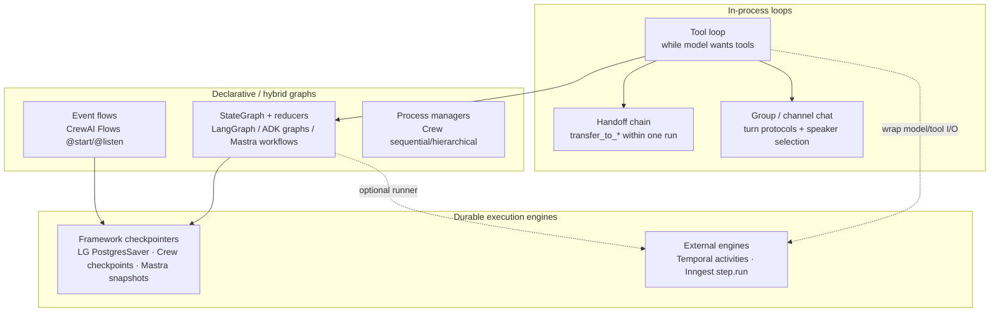
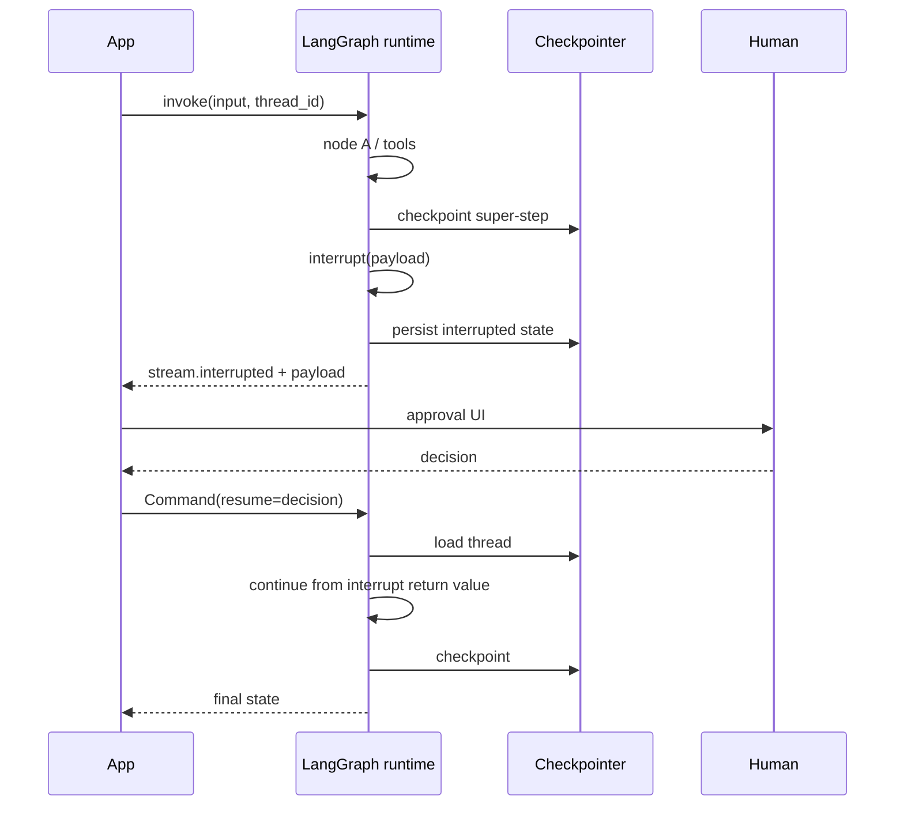
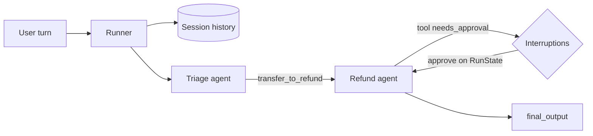
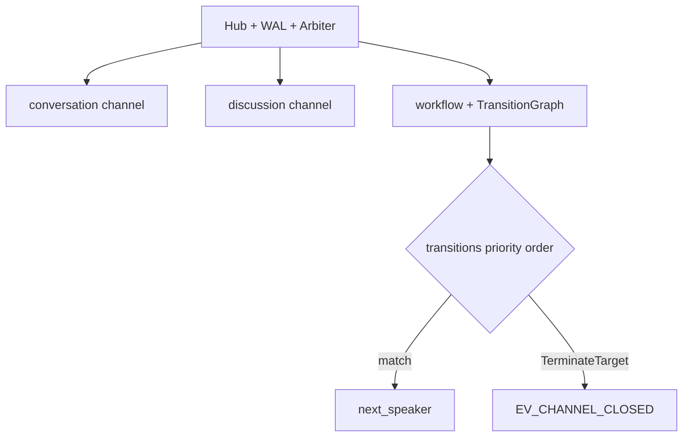
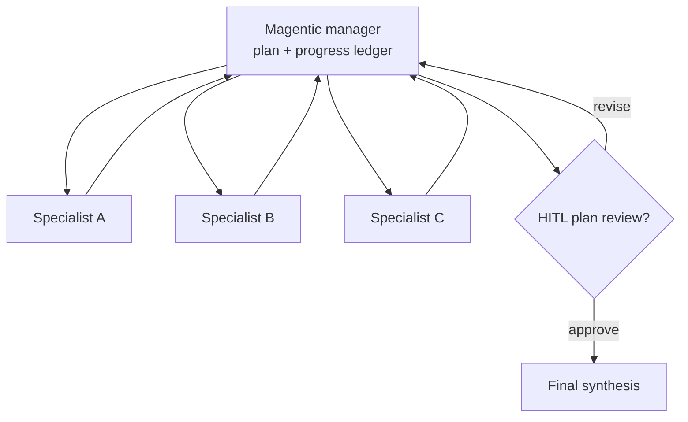
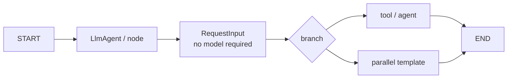
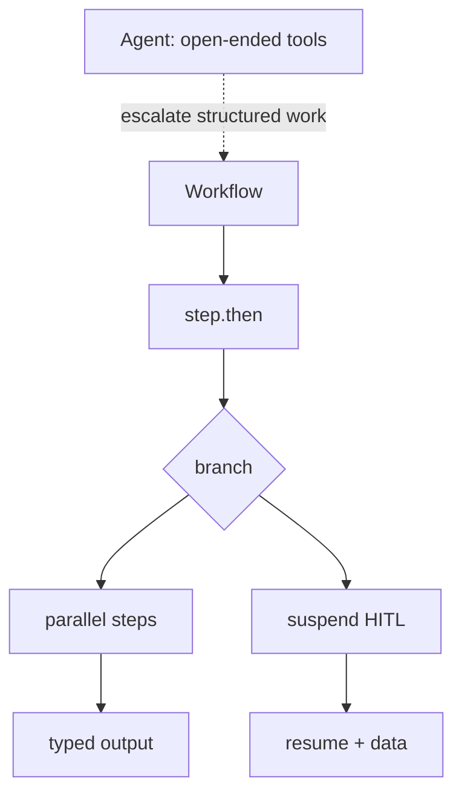
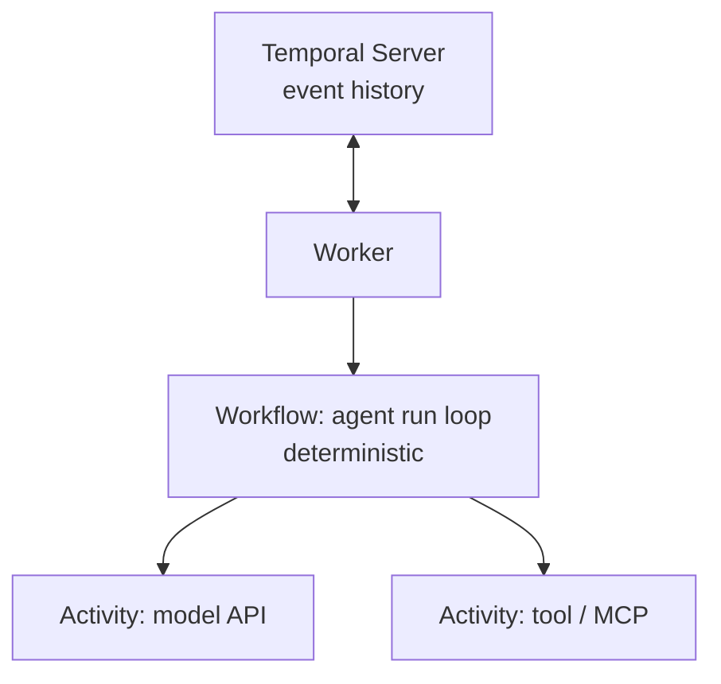
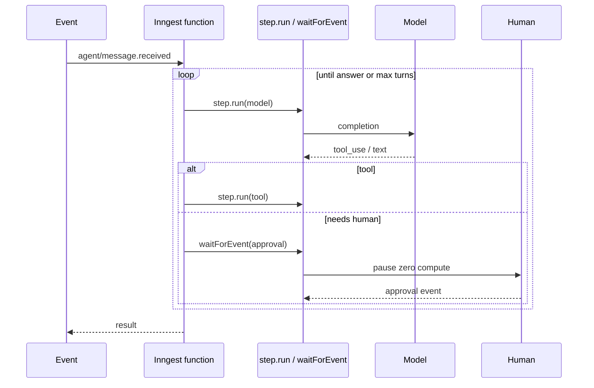
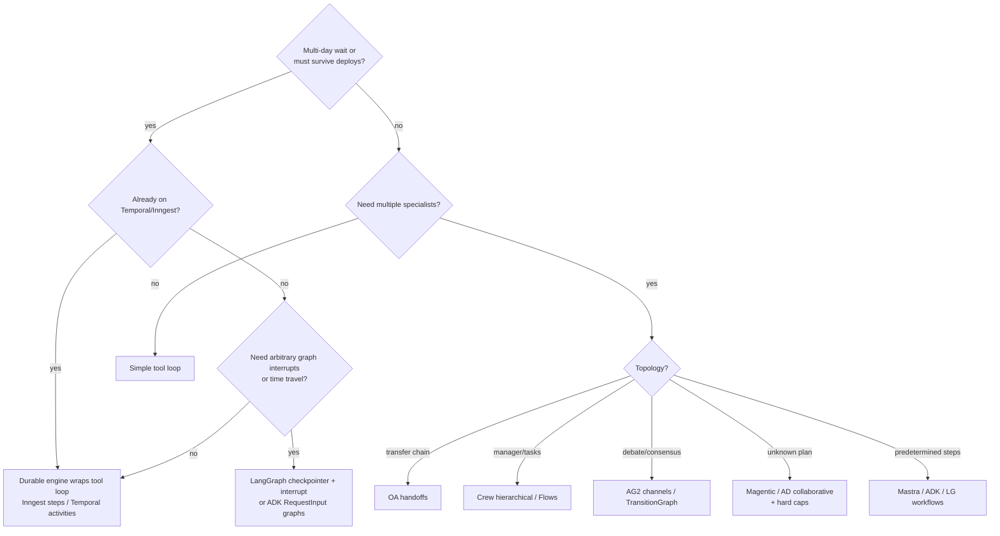

# AFFIX-2026 Deep Dive: Agent Control Planes

**Study:** AFFIX-2026 · **Deliverable:** Architecture / Control Surface  
**As of:** 2026-10-21  
**Inputs:** `benchmark/METHODOLOGY.md`, dossiers (LG, OA, AG, CR, SK, AD, MA), spot-check IN, findings (FMC, proprietary), primary docs 2025–2026  
**Companion:** [`architecture_control_planes.json`](./architecture_control_planes.json)

---

## 0. Thesis

An agent framework’s **control plane** is not “does it call tools.” It is the set of primitives that answer:

1. **Who decides the next step?** (LLM tool choice · declarative graph · channel adapter · process manager · durable workflow engine)
2. **What state survives a process death?** (nothing · chat history · thread checkpoint · WAL · Temporal/Inngest step log)
3. **How does a human pause execution?** (prompt-only ask · tool approval · interrupt-anywhere · deterministic HITL node · `waitForEvent`)
4. **What is the unit of recovery?** (whole run · graph super-step · task · model/tool activity · channel envelope)

Teams fail production when they pick a control plane for **demo topology vocabulary** (crew / swarm / handoff / Magentic) and discover too late that **durability, isolation, and cost bounds** are different primitives that do not transfer.

This memo compares the Tier-A control planes that matter for orchestration decisions, then contrasts them with **true durable execution** (Temporal / Inngest) and the cases where a **simple tool loop wins**.

---

## 1. Control-plane taxonomy



| Family | Decides next step | Survives crash? | Typical HITL | Cognitive tax |
|--------|-------------------|-----------------|--------------|---------------|
| Simple tool loop | Model tool calls | Only if you add it | Rare / BYO | Lowest |
| Handoff runtime (OA) | Model picks `transfer_to_*` | Sessions + `RunState` (not Temporal-class by default) | Tool `needs_approval` | Low |
| Conversation network (AG2) | Adapter + TransitionGraph / speaker rules | Hub WAL (channel-scoped) | `context.input` in tool | High |
| Role process (CrewAI) | Task order or manager delegation | Flow/crew checkpoints | Task `human_input` / `@human_feedback` | Low–mid |
| Planner Magentic (SK/MAF) | Manager plans next agent | Runtime-dependent; SK orchestration experimental | Manager Q&A / group human | Mid–high |
| Graph runtime (LG / ADK / Mastra) | Edges + conditionals (+ LLM nodes) | First-class checkpoints / snapshots | `interrupt` / `RequestInput` / suspend | Mid–high |
| Durable engine (Temporal / Inngest) | Your code + step boundaries | Engine event history | Signals / `waitForEvent` | Mid (platform) |

---

## 2. Framework deep comparisons

### 2.1 LangGraph — checkpoint + interrupt control plane

**Primitive model:** A compiled graph of nodes/edges over a typed state with **reducers**. Persistence is two systems ([Persistence](https://docs.langchain.com/oss/python/langgraph/persistence)):

| | Checkpointer | Store |
|--|--------------|-------|
| Persists | Graph state snapshots | App-defined KV |
| Scope | Single `thread_id` | Cross-thread |
| Use | Continuity, HITL, time travel, fault tolerance | Preferences, facts, shared knowledge |

**Interrupt semantics** ([Interrupts](https://docs.langchain.com/oss/python/langgraph/interrupts)): call `interrupt(payload)` anywhere in a node; runtime persists state and waits indefinitely; resume by re-invoking with `Command(resume=...)`. Requirements: durable checkpointer + `thread_id` + JSON-serializable payload. Streaming surfaces `stream.interrupts` / `stream.interrupted`.

**Checkpoint semantics** ([Checkpointers](https://docs.langchain.com/oss/python/langgraph/checkpointers)): snapshot per **super-step**; pending writes from successful sibling nodes are kept so resume does not re-run them; enables time travel / fork. Production savers: Postgres/SQLite; `InMemorySaver` does not survive restarts. Agent Server can own persistence.



**What this control plane is uniquely good at**

- Arbitrary pause points (not only “before tool X”).
- Fan-out/join via `Send`, subgraphs, mixed deterministic + agentic nodes.
- Crash recovery at super-step granularity with pending-write awareness.
- Highest AFFIX Control Surface in-set (dossier CS **95**).

**What breaks in production**

- **Wrong saver:** InMemory in prod → silent amnesia after deploy.
- **Subgraph checkpoint namespaces:** parent/child state pitfalls documented; easy to “lose” interrupt support if subgraph not checkpointed ([Subgraphs](https://docs.langchain.com/oss/python/langgraph/use-subgraphs)).
- **Durability mode races:** async durability means checkpoint lag; community issues on durability-mode interrupt edge cases (e.g. [#6362](https://github.com/langchain-ai/langgraph/issues/6362)).
- **CTI cliff:** teams that needed a tool loop inherit reducer/thread/checkpoint vocabulary (CTI **82** EST).
- **Lock-in:** checkpoint schemas + optional Agent Server / LangSmith gravity (LIE high in proprietary findings).

**When a simple tool loop wins:** chat Q&A, single-tool CRUD, no multi-day HITL, no map-reduce. Prefer LangChain `create_agent` (already compiles onto LangGraph) over raw `StateGraph` until you need interrupts/fan-out ([overview](https://docs.langchain.com/oss/python/langgraph/overview)).

---

### 2.2 OpenAI Agents SDK — handoffs + sessions + approval interruptions

**Primitive model:** Few concepts — Agent, tools, handoffs, guardrails, Runner, Sessions ([SDK home](https://openai.github.io/openai-agents-python/)).

**Handoffs** ([Handoffs](https://openai.github.io/openai-agents-python/handoffs/)): exposed to the LLM as tools named `transfer_to_<agent>`. Customization via `handoff()`: `input_filter`, `input_type`, `on_handoff`, `is_enabled`, tool name/description overrides. Multi-agent is a **handoff chain within a run**, not GroupChat.

**Sessions** ([Sessions](https://openai.github.io/openai-agents-python/sessions/)): SDK-managed conversation history across runs (SQLite/SQLAlchemy/Redis/Mongo/encrypted backends). Incompatible in the same run with server-managed `conversation_id` / `previous_response_id` continuation.

**HITL** ([Human-in-the-loop](https://openai.github.io/openai-agents-python/human_in_the_loop/)): tools declare `needs_approval`; run returns `interruptions`; serialize via `RunState`; approve/reject; resume with same session. Approvals surface on the **outer** run even for handoff targets and nested `Agent.as_tool()`.



**API realities that bite**

- Tool guardrails do **not** apply to handoff tool calls; input guardrails only on first agent; output guardrails only on final agent ([Guardrails](https://openai.github.io/openai-agents-python/guardrails/) — dossier).
- Handoff history can forward prior tool args/results unless `input_filter` / nest options reshape it — compliance leak surface.
- Restate integration exists for lightweight durable agents ([Running agents](https://openai.github.io/openai-agents-python/running_agents/)); default path is still in-process Runner + session store, not Temporal.

**Production breaks**

- Treating Sessions as crash-durable workflow state (they are conversation memory, not step-idempotent execution).
- ZDR orgs lose tracing ([Tracing](https://openai.github.io/openai-agents-python/tracing/)).
- MaxTurnsExceeded without explicit budgets → cost spikes on handoff ping-pong.
- Highest ops lock-in among serious runtimes (Responses + Traces + Sandbox gravity) despite LiteLLM/AnyLLM adapters.

**When a simple tool loop wins:** one specialist agent, no transfer topology, OpenAI-only or not — use a single Agent without handoffs. Handoffs add history-filter and guardrail-boundary complexity for little gain on linear tasks.

---

### 2.3 AutoGen / AG2 — GroupChat → Network adapters + TransitionGraph

**Primitive model (v1 Network):** Hub owns registry, **WAL**, audit; agents talk over **channels** governed by **adapters** ([Adapters overview](https://docs.ag2.ai/latest/docs/beta/network/adapters_overview/)):

| Adapter | Participants | Turn order | Termination |
|---------|--------------|------------|-------------|
| `consulting` | Exactly 2 | Strict 1Q1R | Auto-closes after reply |
| `conversation` | Exactly 2 | Free-form | Explicit close or TTL — **never auto-closes** |
| `discussion` | 2+ | Round-robin | Explicit close or TTL |
| `workflow` | 2+ | Declarative `TransitionGraph` | `TerminateTarget` / `max_turns` |

`workflow` + `TransitionGraph` is the modern replacement for classic `GroupChat + handoffs` ([Workflow adapter](https://docs.ag2.ai/latest/docs/beta/network/workflow/)). Adapter state is a pure fold of the channel WAL (replayable on `Hub.hydrate()`).

**Classic (`ag2-classic`):** retains `GroupChat` / swarms / nested chats under `import autogen`. **v1 is not drop-in** ([ag2 README](https://github.com/ag2ai/ag2)).

**HITL:** call `await context.input(...)` inside a tool with `hitl_hook` returning `HumanMessage`; Network also supports `HumanClient` participants (dossier).



**Production breaks**

- Unbounded `conversation` channels → runaway token cost (docs: never auto-closes).
- Classic vs v1 import confusion mid-migration.
- WAL polling / timeout patterns can miss messages if not using documented wait patterns (dossier).
- Durability is **channel transcript / adapter fold** — not Temporal-style activity idempotency for arbitrary side effects.
- Highest CTI among serious multi-agent runtimes (~38 concepts EST).

**When a simple tool loop wins:** you do not need debate/consensus protocols. AG2’s power is conversational topology density (GED leader); paying Hub/Passport/Rules tax for a sequential research→write pipeline is usually wrong — use Crew Flows, Mastra workflows, or LG.

---

### 2.4 CrewAI — Process + Flows

**Process control plane** ([Processes](https://docs.crewai.com/v1.15.28/en/concepts/processes)):

- **Sequential:** task list order; prior outputs as context.
- **Hierarchical:** manager (`manager_llm` or `manager_agent`) plans, delegates, validates — corporate org chart mental model ([Hierarchical](https://docs.crewai.com/edge/en/learn/hierarchical-process)).

**Flows** ([Flows](https://docs.crewai.com/v1.15.28/en/concepts/flows)): event-driven `@start` / `@listen` / routers; shared `self.state`; combine code, LLM calls, and crews. HITL via task `human_input` and Flow `@human_feedback` (+ enterprise webhook resume).

**Checkpointing** ([Checkpointing](https://docs.crewai.com/v1.15.23/en/concepts/checkpointing)): event-driven snapshots (default `task_completed`); JsonProvider / SqliteProvider; restore skips completed tasks; fork via lineage ID. Auto-checkpoint writes are **best-effort** (failed write logged, run continues) — unlike Temporal’s hard durability contract.

```mermaid
flowchart TB
  subgraph Crew["Crew process"]
    seq[Process.sequential]
    hier[Process.hierarchical + manager]
  end
  subgraph Flows["Flow runtime"]
    start[@start]
    listen[@listen / router]
    hf[@human_feedback]
    cp[(checkpoints)]
  end
  start --> listen
  listen --> Crew
  listen --> hf
  Crew --> cp
  Flows --> cp
```

**Production breaks**

- Hierarchical without `manager_llm` / `manager_agent` misconfig.
- Human feedback injected wholesale into task context derails later steps.
- HITL webhook resume URL drops (enterprise path).
- Concurrent state races less explicit than graph reducers (FMC CSR = N in matrix).
- AMP gravity for tracing / enterprise HITL (LIE edge).

**When a simple tool loop wins:** one agent, one task, no role theater. Crew’s DX win collapses into ceremony when “researcher + writer” is really one prompt with two tool groups.

---

### 2.5 Semantic Kernel Magentic (+ MAF succession)

**SK orchestration patterns** (still labeled **experimental**) ([Agent Orchestration](https://learn.microsoft.com/en-us/semantic-kernel/frameworks/agent/agent-orchestration/)):

| Pattern | Coordination |
|---------|--------------|
| Concurrent | Broadcast; independent results |
| Sequential | Pipeline |
| Handoff | Dynamic transfer by context ([Handoff](https://learn.microsoft.com/en-us/semantic-kernel/frameworks/agent/agent-orchestration/handoff)) |
| Group Chat | Manager-coordinated conversation; optional human |
| Magentic | Group-chat architecture + powerful planning manager (Magentic-One lineage) |

**MAF Magentic** ([Magentic orchestration](https://learn.microsoft.com/en-us/agent-framework/workflows/orchestrations/magentic)): same architecture as Group Chat with a manager that plans, tracks progress, adapts; supports HITL plan review. Docs note it is **untested outside Magentic-One-like designs**. Microsoft positions **Agent Framework** as successor to SK + AutoGen concepts ([Overview](https://learn.microsoft.com/en-us/agent-framework/overview/), [migration](https://learn.microsoft.com/en-us/agent-framework/migration-guide/from-semantic-kernel)).



**Production breaks**

- Building greenfield on experimental SK orchestration while MAF is the marketed path → double migration (succession tax; proprietary finding #5).
- Magentic manager loops without hard turn/cost caps → open-ended spend.
- Python/.NET feature skew.
- HITL less deterministic than ADK `RequestInput` nodes (dossier EST).

**When a simple tool loop wins:** known pipeline of 2–3 steps. Magentic’s value is **unknown solution path**; if the path is known, Sequential/Handoff (or a non-SK workflow) is cheaper and more testable.

---

### 2.6 Google ADK — workflows, graphs, RequestInput

**Workflow families** ([Workflows](https://adk.dev/workflows/)):

1. **Graph-based** — agents + deterministic nodes, branching  
2. **Dynamic** — programmatic control flow with automatic checkpointing of successful sub-nodes ([Dynamic](https://adk.dev/graphs/dynamic/))  
3. **Collaborative** — coordinator + sub-agents  
4. **Template** — sequence / loop / parallel  

**HITL:** `RequestInput` nodes pause without requiring a model — deterministic pause for data, decision, or permission ([Human input](https://adk.dev/graphs/human-input/)). Resume semantics interact with `rerunOnResume` (misconfig → lost or double work; dossier).

**Cross-runtime:** A2A for agent-to-agent across runtimes ([A2A](https://adk.dev/a2a/)). Observability: OTel GenAI → Cloud Trace ([Traces](https://adk.dev/observability/traces/)).



**Production breaks**

- GCP Agent Runtime / Cloud Run / GKE gravity despite LiteLLM model adapters.
- `rerunOnResume` double-execution of non-idempotent tools.
- Context compaction dropping tool-critical details (EST).
- Experimental agent routing instability.
- Weaker free-form debate than AG2 (by design — workflow bias).

**When a simple tool loop wins:** single `LlmAgent` + tools without graph. ADK’s strength is **predictable multi-node structure**; do not invent a graph for a ReAct loop.

---

### 2.7 Mastra — TS workflows vs agents

**Split brain (intentional):** ([Workflows overview](https://mastra.ai/docs/workflows/overview))

- **Agents** — open-ended tool loops  
- **Workflows** — predetermined multi-step control: `createStep` / `createWorkflow`, `.then()` / `.branch()` / `.parallel()`, typed I/O schemas  

**Suspend/resume** ([Suspend and resume](https://mastra.ai/docs/workflows/suspend-and-resume)): pause for human/external input; resume saved runs; recover interrupted executions. Docs note managed runners such as **Inngest** for durable infrastructure beyond the built-in engine.



**Production breaks**

- Using agents for predetermined ETL-like chains (non-deterministic cost/latency).
- Using workflows for open-ended research (rigidity / step explosion).
- Assuming built-in engine equals Inngest/Temporal durability without configuring a runner.
- Smaller hiring pool than LangGraph/Python ecosystem.

**When a simple tool loop wins:** product chat with tools and Zod structured output — stay on `agent.generate()` / `stream()`; add workflows only when step order is a product requirement.

---

### 2.8 Durable systems vs in-process loops

#### Temporal (and PydanticAI integration)

Temporal separates **deterministic workflow** code from **activities** (I/O). For agents, model calls and tools become activities; the agent loop lives in the workflow ([Pydantic AI + Temporal](https://pydantic.dev/docs/ai/capabilities/durable_execution/temporal/), [Temporal Durable AI](https://docs.temporal.io/ai)).



**Contract:** crash → replay history → skip completed activities → continue. Multi-day human waits via signals. **Cost:** determinism discipline (no free I/O in workflow), worker ops, activity heartbeat/timeout design.

#### Inngest durable agents

Write the agent loop in normal async code; wrap model/tool calls in `step.run()`; HITL via `step.waitForEvent()`; sub-agents via `step.invoke` ([Durable Agents](https://www.inngest.com/docs/durable-execution/durable-agents)). **No graph to declare.** On resume, completed steps return memoized results (deterministic replay of dynamic steps). Waits hold no worker.



**Framework checkpointers vs engines**

| Layer | Example | Guarantees |
|-------|---------|------------|
| In-process loop | raw OA Runner, smolagents | Lose all mid-run progress on kill |
| Framework checkpointer | LG PostgresSaver, Crew checkpoints, Mastra snapshots, ADK node checkpoints | Resume orchestration state; tool idempotency still app-owned |
| Durable engine | Temporal, Inngest | Step/activity memoization + retries + long waits without holding workers |

**Composition patterns that work**

- **TS product:** Vercel AI SDK (UI) + Mastra (workflows/memory) + Inngest (survival) — typed-dx cluster finding.  
- **Python typed agents:** PydanticAI + Temporal activities.  
- **Graph-native:** LangGraph checkpointer *or* LG steps inside Temporal — pick one source of truth for “what completed,” do not dual-write blindly.

---

## 3. Cross-cutting primitive matrix

See JSON companion for machine-readable fields. Narrative summary:

| Primitive | LG | OA | AG2 | CR | SK/MAF | AD | MA | Temporal/Inngest |
|-----------|----|----|-----|----|--------|----|----|------------------|
| Next-step decider | Edges + LLM nodes | Handoff tools | Adapter / TransitionGraph | Process / Flow events | Orchestration pattern | Graph/dynamic/collab | Workflow DSL / agent | Your code + steps |
| Durable unit | Super-step checkpoint | RunState + session msgs | WAL envelope fold | Task/flow checkpoint | Runtime-specific | Node checkpoint | Workflow snapshot | Activity / step |
| HITL style | `interrupt()` anywhere | Tool approval interruptions | In-tool `context.input` | Task/Flow human | Manager / group human | `RequestInput` node | Workflow suspend | Signal / waitForEvent |
| Multi-agent topology | Subgraphs / Send | Handoff chain | Channels | Crew hierarchy | Magentic/Group/Handoff | Coordinator + graphs | Agent+workflow | step.invoke / child workflows |
| Isolation strength | State reducers | History filters | Channel view policies | Task context | Thread/chat | Node I/O schemas | Step schemas | Activity boundaries |
| Cost bound levers | Graph design | MaxTurns | TTL / max_turns | max iter / RPM | Manager caps (app) | RunConfig | Step limits | Function timeouts / step limits |

---

## 4. What breaks in production (pattern catalog)

### 4.1 False-friend topologies

**Handoff ≠ GroupChat ≠ Hierarchical Process ≠ Magentic** (proprietary finding #8 / cluster multi-agent). Specs diverge on:

- **Isolation:** who sees prior tool args  
- **Concurrency:** one speaker vs N  
- **Cost:** auto-termination vs unbounded conversation  
- **Compliance:** deterministic pause vs “model please ask user”

### 4.2 Memory ≠ durability

Sessions (OA), memory scopes (Crew), KnowledgeStore (AG2), Stores (LG) answer “what does the model remember?”  
Checkpoints / WAL / Temporal history answer “what side effects already happened?”  
Confusing them causes **double charges** after resume.

### 4.3 Best-effort vs hard durability

Crew auto-checkpoint writes can fail and continue ([Checkpointing](https://docs.crewai.com/v1.15.23/en/concepts/checkpointing)). Temporal/Inngest treat step completion as the durability boundary. Choose consciously.

### 4.4 Guardrail / approval boundary bugs

OA: handoffs bypass tool guardrails; nested approvals must be handled on outer `RunState`.  
ADK: `rerunOnResume` re-executes nodes that are not idempotent.  
LG: interrupt resume returns into the middle of a node — side effects before `interrupt()` must be idempotent or guarded.

### 4.5 DX surplus → production cliff

Frameworks with DX ≫ PH ship demos that cannot survive deploy (proprietary RHS). Control-plane choice should be gated by **HIT + DUR + IDE** needs from the FMC catalog, not time-to-first-agent alone.

### 4.6 Succession / dual-stack entropy

SK→MAF and AG Classic→v1 mean the control plane you learn may not be the control plane you operate in 12 months. Prefer frozen APIs (OA handoffs, LG checkpoints, Inngest steps) when succession risk is intolerable.

---

## 5. When a simple tool loop wins

A **simple tool loop** (single agent, tools, max-turns, structured output, optional short chat memory) wins when **all** of the following hold:

1. **Topology is linear** — no specialist transfer, debate, or fan-out/join.  
2. **Wall clock < deploy interval** — run finishes before workers recycle, or loss is acceptable.  
3. **No compliance gate mid-run** — or approval is pre-tool via a single boolean, not multi-day.  
4. **Side effects are naturally idempotent or externally transactional** — payment intents, upserts.  
5. **One bounded context window** — no cross-thread memory product yet.

**Recommended defaults (AFFIX-aligned)**

| Situation | Control plane |
|-----------|---------------|
| Product chat + tools (TS) | Vercel AI SDK / Mastra agent loop |
| Product chat + tools (Python) | PydanticAI or OA single agent |
| Approval-gated long jobs | LG interrupts **or** Inngest/Temporal waits |
| Role team with known tasks | Crew sequential/hierarchical |
| Debate / consensus | AG2 discussion/workflow |
| Unknown open-ended plan | SK/MAF Magentic **or** AD collaborative — with hard caps |
| Predetermined multi-step TS | Mastra workflows (+ Inngest runner if must survive) |
| Predetermined multi-step Python | LG / ADK graphs / PydanticAI graph |

**Anti-pattern:** starting on Magentic/GroupChat/Network “because agents” when a 40-line tool loop + Zod schema ships the KPI.

---

## 6. Decision flowchart



---

## 7. Eight sharp architectural findings

See section at end of this memo (also returned to parent as the study’s control-plane findings set).

---

## 8. Evidence index (primary)

| Topic | URL |
|-------|-----|
| LG persistence | https://docs.langchain.com/oss/python/langgraph/persistence |
| LG checkpointers | https://docs.langchain.com/oss/python/langgraph/checkpointers |
| LG interrupts | https://docs.langchain.com/oss/python/langgraph/interrupts |
| LG overview | https://docs.langchain.com/oss/python/langgraph/overview |
| OA handoffs | https://openai.github.io/openai-agents-python/handoffs/ |
| OA HITL | https://openai.github.io/openai-agents-python/human_in_the_loop/ |
| OA sessions | https://openai.github.io/openai-agents-python/sessions/ |
| OA running / Restate | https://openai.github.io/openai-agents-python/running_agents/ |
| AG2 adapters | https://docs.ag2.ai/latest/docs/beta/network/adapters_overview/ |
| AG2 workflow | https://docs.ag2.ai/latest/docs/beta/network/workflow/ |
| AG2 repo | https://github.com/ag2ai/ag2 |
| Crew processes | https://docs.crewai.com/v1.15.28/en/concepts/processes |
| Crew flows | https://docs.crewai.com/v1.15.28/en/concepts/flows |
| Crew checkpointing | https://docs.crewai.com/v1.15.23/en/concepts/checkpointing |
| SK orchestration | https://learn.microsoft.com/en-us/semantic-kernel/frameworks/agent/agent-orchestration/ |
| SK handoff | https://learn.microsoft.com/en-us/semantic-kernel/frameworks/agent/agent-orchestration/handoff |
| MAF Magentic | https://learn.microsoft.com/en-us/agent-framework/workflows/orchestrations/magentic |
| MAF overview | https://learn.microsoft.com/en-us/agent-framework/overview/ |
| ADK workflows | https://adk.dev/workflows/ |
| ADK dynamic | https://adk.dev/graphs/dynamic/ |
| ADK HITL | https://adk.dev/graphs/human-input/ |
| Mastra workflows | https://mastra.ai/docs/workflows/overview |
| Mastra suspend | https://mastra.ai/docs/workflows/suspend-and-resume |
| Mastra control flow | https://mastra.ai/docs/workflows/control-flow |
| Inngest durable agents | https://www.inngest.com/docs/durable-execution/durable-agents |
| Temporal AI | https://docs.temporal.io/ai |
| PydanticAI Temporal | https://pydantic.dev/docs/ai/capabilities/durable_execution/temporal/ |

---

## 9. Eight sharp architectural findings (detail)

### F1 — Control planes optimize different failure units

**Claim:** LG recovers at **super-step + pending writes**; Inngest/Temporal at **step/activity memoization**; OA at **RunState interruption + session history**; AG2 at **WAL envelope fold**; Crew at **task_completed checkpoints (best-effort auto-write)**. These are not interchangeable “stateful agent” features.

**Falsifier:** Show semantic equivalence of resume-after-kill for a non-idempotent payment tool across LG interrupt, OA session resume, and Inngest `step.run` without app-level idempotency keys.

### F2 — HITL quality is ternary, not binary

**Claim:** Production HITL splits into (a) **deterministic nodes** (ADK `RequestInput`, Crew `@human_feedback`, Mastra suspend), (b) **approval interruptions** (OA `needs_approval` / `RunState`), (c) **in-tool pauses** (AG2 `context.input`, LG `interrupt()` mid-node). Prompt-only “ask the user” is not a control plane.

**Evidence:** [ADK human input](https://adk.dev/graphs/human-input/), [OA HITL](https://openai.github.io/openai-agents-python/human_in_the_loop/), [LG interrupts](https://docs.langchain.com/oss/python/langgraph/interrupts).

### F3 — Highest CS does not minimize rewrite hazard

**Claim:** LangGraph CS leadership (95) coexists with higher RHS than Mastra/OA because CTI + weak RACS + checkpoint lock-in dominate 12-month stack survival (proprietary finding #2).

**Falsifier:** Cohort study: LG-first teams rewrite primary orchestration less often than MA/PD at equal multi-agent complexity.

### F4 — Topology false friends are the #1 POC→prod killer

**Claim:** Teams treating OA handoffs, AG2 GroupChat/channels, Crew hierarchical, and Magentic as synonyms fail isolation and cost reviews. Spec each as: speaker cardinality, termination, history visibility, pause determinism.

**Evidence:** Cluster multi-agent insight #2; AG2 adapter table; OA handoff tool model; Crew process docs.

### F5 — Durable engines beat framework checkpointers for zero-compute waits

**Claim:** Multi-hour/day human approvals should use Temporal signals or Inngest `waitForEvent` (no worker held). Framework checkpointers keep orchestration place but typically still couple to app process lifecycle and do not memoize model spend the same way.

**Evidence:** [Inngest durable agents](https://www.inngest.com/docs/durable-execution/durable-agents), [Temporal AI](https://docs.temporal.io/ai).

### F6 — Simple tool loops dominate the median production agent

**Claim:** EST: majority of shipped “agents” never need fan-out, debate, or Magentic planning. Over-selecting rich control planes raises CTI and failure surface without KPI lift. Gate rich planes on an explicit topology/durability requirement checklist (Section 5).

**Falsifier:** Product analytics showing >50% of production runs use ≥3 agents with non-linear topology in a representative SaaS cohort.

### F7 — Microsoft and AG2 carry succession tax on the control plane itself

**Claim:** SK experimental orchestration → MAF, and AG Classic → Network v1, mean the **coordination API** is unstable even when model adapters are fine. Prefer OA/LG/Inngest primitives when API freeze matters more than pattern catalog breadth.

**Evidence:** [SK orchestration experimental banner](https://learn.microsoft.com/en-us/semantic-kernel/frameworks/agent/agent-orchestration/), [MAF overview](https://learn.microsoft.com/en-us/agent-framework/overview/), [ag2 not drop-in](https://github.com/ag2ai/ag2).

### F8 — Compose layers; do not seek one framework for UI + graph + durability

**Claim:** Winning stacks are layered: typed UX (VS/PD) × orchestration (MA/LG/AD/OA) × durability (Inngest/Temporal/LG checkpointer). Single-framework absolutism either under-hardens (VS alone) or over-taxes (raw LG for a chat box).

**Evidence:** typed-dx cluster; IN spot-check; proprietary finding on VS+MA / VS+Inngest.

---

*All numeric AFFIX/LIE/CTI/FMC/GED/RACS/RHS values cited from dossiers/matrices are **EST** per METHODOLOGY — not wall-clock benchmarks.*
